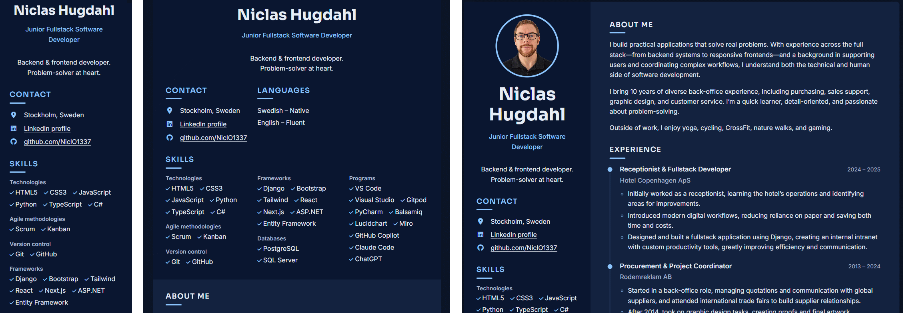
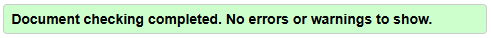
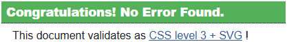
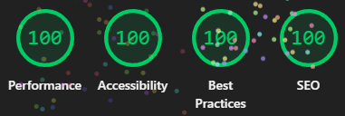
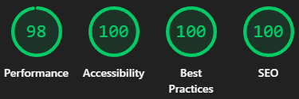
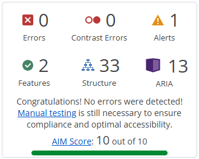

# Testing – Modern CV

[Back to README](README.md)

## Table of contents

* [Manual testing](#manual-testing)
* [Responsiveness](#responsiveness)
* [Browser compatibility](#browser-compatibility)
* [Validator testing](#validator-testing)
* [Lighthouse](#lighthouse)
* [Accessibility](#accessibility)
* [Bugs](#bugs)

This project has no automated tests. All testing was done manually.

## Manual testing

| Feature | Action | Expected result | Result |
|---------|--------|-----------------|--------|
| Theme toggle | Click the moon/sun button | Switches between light and dark mode, icon and label update | PASS |
| Theme memory | Choose dark mode, reload page | Dark mode is still active | PASS |
| System theme | No saved choice, OS set to dark | Site opens in dark mode | PASS |
| Download CV | Click Download CV | PDF downloads, does not contain private contact info | PASS |
| LinkedIn link | Click LinkedIn | Opens LinkedIn profile in new tab | PASS |
| GitHub link | Click GitHub | Opens GitHub profile in new tab | PASS |
| Keyboard | Tab through the page | Every link/button is reachable with a visible focus outline | PASS |
| No false hovers | Hover over headings, photo, skills | Nothing changes, cursor stays default | PASS |

## Responsiveness

Tested with Chrome DevTools and on real devices.

| Width / device | Layout as expected | Result |
|----------------|--------------------|--------|
| 320px (small phone) | One column, no horizontal scroll | PASS |
| 390px (iPhone) | One column | PASS |
| 768px (tablet) | Sidebar sections side by side | PASS |
| 1024px (laptop) | Two-column CV | PASS |
| 1440px+ (desktop) | Two-column CV, card centred | PASS |
| Real phone: Galaxy Fold 5 | | PASS |

## Browser compatibility

| Browser | Result |
|---------|--------|
| Chrome | PASS |
| Firefox | PASS |
| Edge | PASS |
| Brave | PASS |

## Validator testing

- HTML: [W3C Markup Validator](https://validator.w3.org/) – PASSED
 
- CSS: [W3C Jigsaw CSS Validator](https://jigsaw.w3.org/css-validator/) – PASSED
 
 The validator reported one false error caused by its outdated CSS support. It was fixed, see [Fixed bugs](#fixed-bugs).
 Jigsaw shows warnings only for var() values and for the Font Awesome CDN file. These are not errors.

## Lighthouse

### Desktop result:

### Mobile result:

## Accessibility

[WAVE](https://wave.webaim.org/) was run on lightmode and darkmode. WAVE sorts its findings into errors (real failures) and alerts (things a human should check). Errors must be 0. Each alert was checked by hand.

| Page | Alert | Count | Where | Decision |
|------|-------|:-----:|-------|----------|
| Link to PDF document | 1 per page | "Download CV" | Left as is: the link text already says it is a file download, which is what the alert asks for. WAVE cannot check the PDF itself. The CV is a tagged PDF with real text, exported from Word. |

## Bugs

### Fixed bugs
- **CSS validator error caused by an outdated validator.** The W3C Jigsaw validator reported
  `Value Error : width – The types are incompatible` for `.toolbar, .cv`. The line was
  `width: min(1100px, 100% - 2 * var(--space-4));`. This is valid CSS that current browsers
  support, but Jigsaw cannot handle `var()` inside `min()` or `calc()`. Small test snippets
  confirmed this: the validator accepted `min(1100px, calc(100% - 3rem))` and `max-width: 1100px`,
  but rejected every version with `var()` in the calculation. The fix was to remove the
  calculation. The side space now comes from `padding-inline` on `body`, and the toolbar and card
  use `max-width: 1100px` with automatic side margins. The layout looks the same as before.

### Unfixed bugs
- None known
