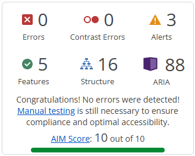

# Testing – Developer Portfolio

[Back to README](README.md)

## Table of contents

* [Automated testing](#automated-testing)
    * [Setup](#setup)
    * [Unit tests](#unit-tests)
    * [Integration tests](#integration-tests)
    * [Test results](#test-results)
* [Manual testing](#manual-testing)
    * [Navigation and links](#navigation-and-links)
    * [Projects filter](#projects-filter)
    * [Contact form](#contact-form)
    * [Theme and effects](#theme-and-effects)
* [Responsiveness](#responsiveness)
* [Browser compatibility](#browser-compatibility)
* [Performance](#performance)
* [Validator testing](#validator-testing)
* [Lighthouse](#lighthouse)
* [Accessibility](#accessibility)
* [Bugs](#bugs)


## Automated testing

### Setup

Tests are written with [Vitest](https://vitest.dev/) and
[React Testing Library](https://testing-library.com/docs/react-testing-library/intro/)
in a jsdom environment. Each component's test file sits next to the
component. Integration tests are in `src/test/integration/`, and they
render the real route configuration with a memory router.

```bash
npm test           # watch mode
npm run test:run   # run once
```

### Unit tests

Every file passes. Counts are the number of tests in each file.

| File | What is tested | Tests | Result |
|------|----------------|:-----:|--------|
| `utils/projects.test.js` | find by slug, featured project, tech list, filtering, host name (also for text that is not a URL or a lookalike host), previous/next with wrap-around, a single project | 21 | PASS |
| `utils/validateContact.test.js` | required fields, only-spaces, valid and invalid emails (also Swedish letters and spaces around), emoji and several lines | 21 | PASS |
| `utils/toSlug.test.js` | slugs for names like `Next.js`, `ASP.NET`, `C#` and `C++`, repeated symbols, empty text | 8 | PASS |
| `utils/shuffle.test.js` | same items, original not changed, empty and single-item arrays | 3 | PASS |
| `data/data.test.js` | unique ids and slugs, no repeated text where text is the React key, unique filter slugs, newest first, one featured project, alt text of 100 characters or less, https links that can be read as URLs, CV file exists, GitHub and LinkedIn ids, no email or phone | 16 | PASS |
| `hooks/useLocalStorage.test.js` | initial value, read, write, invalid JSON fallback, blocked and full storage | 6 | PASS |
| `hooks/useMediaQuery.test.js` | match, no match, updates, only its own query | 4 | PASS |
| `hooks/useRouteFocus.test.jsx` | focus moves to the new `<h1>`, not on first load, not on search changes | 3 | PASS |
| `context/EffectsProvider.test.jsx` | effects on, off, reduced motion, touch screen, error outside the provider | 5 | PASS |
| `ThemeToggle.test.jsx` | dark by default, switch back and forth, saved choice | 4 | PASS |
| `EffectsToggle.test.jsx` | on by default, toggle and save, hidden on touch and reduced motion | 5 | PASS |
| `NavMenu.test.jsx` | links, `aria-current` on the current page | 2 | PASS |
| `MobileHeader.test.jsx` | open and close, closes on link click, route change and click outside | 9 | PASS |
| `SkipLink.test.jsx` | first thing Tab reaches, points to the main content | 1 | PASS |
| `Button.test.jsx` | element type, internal link, external link attributes, file download | 5 | PASS |
| `ProjectCard.test.jsx` | content, image alt, links, optional live and GitHub buttons | 7 | PASS |
| `ProjectFilter.test.jsx` | chips, `aria-pressed`, selected technology | 4 | PASS |
| `Timeline.test.jsx` | order, `<time>` elements, organisation and bullets | 3 | PASS |
| `ContactForm.test.jsx` | validation, honeypot, spaces trimmed before sending, Enter does not send from name or email, sending state, success, error (also for an answer that is not JSON or not `success: true`), retry | 27 | PASS |
| `FormField.test.jsx` | label connected to input, textarea, input type, error message | 5 | PASS |
| `BentoTile.test.jsx` | title and heading level, spotlight | 4 | PASS |
| `SkillGroup.test.jsx` | heading, list of skills, decorative icons hidden | 2 | PASS |
| `SocialLinks.test.jsx` | one link per profile, new tab with accessible name | 2 | PASS |
| `TechMarquee.test.jsx` | skills data, repeated copy hidden from screen readers, same order | 3 | PASS |
| `Footer.test.jsx` | landmark, credit line, current year | 1 | PASS |
| `Reveal.test.jsx` | hidden until in view, shown at once without effects or on touch, shown when effects are turned off while hidden | 5 | PASS |
| `PageTransition.test.jsx` | fade in, off without effects, restarts on path change only | 3 | PASS |
| `CursorTrail.test.jsx` | canvas hidden from screen readers, drawing, theme colour, stops when idle or hidden, one frame at a time, 60-point limit, new trail after the tab returns, no canvas support, resize | 13 | PASS |
| `CustomCursor.test.jsx` | pointer hidden and restored, follows the mouse, ring grows over links | 5 | PASS |
| `Spotlight.test.jsx` | follows the mouse, hides on leave, off without effects or on touch | 5 | PASS |
| `RootLayout.test.jsx` | cursor effects on, off, and on a touch screen | 3 | PASS |
| `HomePage.test.jsx` | greeting, featured project, CV link, photo alt text | 4 | PASS |
| `AboutPage.test.jsx` | heading, bio, skills | 3 | PASS |
| `ResumePage.test.jsx` | heading, CV download, experience and education newest first | 2 | PASS |
| `ProjectsPage.test.jsx` | all cards, filter in the URL, empty result | 6 | PASS |
| `ProjectDetailPage.test.jsx` | content, links, back link keeps the filter, previous/next, unknown project | 7 | PASS |
| `ContactPage.test.jsx` | heading and form, no email or phone shown | 2 | PASS |
| `NotFoundPage.test.jsx` | heading and links back home and to projects | 1 | PASS |
| `pageTitles.test.jsx` | own title and description on every page | 7 | PASS |

### Integration tests

The tests in `src/test/integration/` render the real routes with a memory router.

| File | Flow | Tests | Result |
|------|------|:-----:|--------|
| `navigation.test.jsx` | Every nav link opens its page, marks itself active and moves focus to the `<h1>` | 20 | PASS |
| | Deep links open the right page and nav link directly | | |
| | Unknown URLs and unknown projects show the 404 page inside the layout, with working links | | |
| `projectsFlow.test.jsx` | Filter, open a card and go back to the same filter | 5 | PASS |
| | Previous/next with wrap-around, filter kept while moving between projects | | |
| | Browser back button undoes the filter and the opened card | | |
| `contact.test.jsx` | Sends the message (mocked `fetch`) and thanks the visitor | 2 | PASS |
| | Shows an error inside the page, with the navigation still usable | | |
| `toggles.test.jsx` | Theme and effects choices stay on every page and after reopening | 5 | PASS |
| `errors.test.jsx` | A crash on a page shows "Something went wrong", also on a project page (not a 404) | 4 | PASS |
| | An unknown project still shows the 404 inside the layout, and "Back to home" leads out of the error page | | |
| `pageRules.test.jsx` | Every page (all 14, including every project) has one `<h1>` and no skipped heading level, one `<main>` that the skip link leads to, no repeated ids | 85 | PASS |
| | Every image has alt text, every link, button and field has a name, every link to another site opens in a new tab with `rel="noopener"`, and no two pages share a title | | |

### Test results

**45 test files, 359 tests: all PASS** (`npm run test:run`).

TODO: screenshot of `npm run test:run` output


## Manual testing

### Navigation and links

| Feature | Action | Expected result | Result |
|---------|--------|-----------------|--------|
| Sidebar nav | Click each link (desktop) | Correct page, active indicator | TODO |
| Mobile menu | Open, click link, Escape | Menu works and closes | TODO |
| Skip link | Tab on load, Enter | Focus jumps to main content | TODO |
| Refresh on sub-page | Refresh `/projects` on live site | Page loads (no Vercel 404) | TODO |
| Project links | Click Live and GitHub on every project | Correct site opens in a new tab | TODO |
| Download CV | Click the button on Home and Resume | PDF downloads | TODO |
| Social links | Click GitHub and LinkedIn | Correct profiles open | TODO |

### Projects filter

| Action | Expected result | Result |
|--------|-----------------|--------|
| Click a tech chip | Only matching projects, count updates | TODO |
| Click "All" | All projects shown, `?tech` removed from URL | TODO |
| Browser back after filtering | Previous filter restored | TODO |
| Open `/projects?tech=react` directly | React filter active | TODO |

### Contact form

| Action | Expected result | Result |
|--------|-----------------|--------|
| Submit empty | Errors on all fields | TODO |
| Fill in everything, then press Enter in Name or Email | Nothing is sent. Enter in Message adds a new line | TODO |
| Tab to "Send message", press Enter or Space | The message is sent | TODO |
| Invalid email | Email error | TODO |
| Valid submit (live site) | Success message, email received | PASS |
| Offline submit | Error message with fallback | TODO |
| Vercel → Settings → Environment Variables | `VITE_WEB3FORMS_KEY` exists for Production. Redeploy after adding or changing it: Vite puts the value into the build, and without it every message fails with "could not be sent" | PASS |

### Theme and effects

| Action | Expected result | Result |
|--------|-----------------|--------|
| Toggle theme, reload | Theme remembered, no flash of wrong theme | TODO |
| Toggle effects off | Trail, custom cursor and animations stop | TODO |
| OS reduced motion on | Effects off automatically | TODO |
| Touch device | No trail or custom cursor | TODO |


## Responsiveness

| Width / device | Result |
|----------------|--------|
| 320px | PASS |
| 375–390px (phone) | PASS |
| 768px (tablet) | PASS |
| 1024px (split layout starts) | PASS |
| 1440px+ | PASS |
| Real phone: Samsung Galaxy Fold 5 | PASS |


## Browser compatibility

| Browser | Result |
|---------|--------|
| Brave | TODO |
| Chrome | TODO |
| Firefox | TODO |
| Edge | TODO |


## Performance

Effects were checked in Chrome DevTools → Performance with 4× CPU throttling,
on the production build (`npm run build` and `npm run preview`) in an
Incognito window.

| Check | Result |
|-------|--------|
| Cursor trail and custom cursor, normal and fast mouse movement | Smooth |
| Spotlight on the bento tiles, normal movement | Smooth |
| Spotlight on the project cards | Still laggy when moving fast across several cards at 4×, so it was removed from the cards |

What changed because of the testing:
- The canvas has one pixel per CSS pixel, so it has 4 to 9 times fewer pixels to draw on sharp screens.
- The spotlight has no `will-change` and no fade, because its own layer inside a rounded `overflow: hidden` tile lagged.
- The spotlight was removed from the project cards. Removing their glow transition instead changed little, so the glow stayed.
- Drawing the trail in batched fade levels was tried and reverted: it was not smoother and looked jagged.

TODO: screenshot of a Performance recording


## Validator testing

- HTML: [W3C Markup Validator](https://validator.w3.org/) on the built pages – TODO
- CSS: [W3C Jigsaw](https://jigsaw.w3.org/css-validator/) – TODO (CSS Modules output in `dist/`)
- ESLint: `npm run lint` with no errors – TODO


## Lighthouse

TODO: mobile and desktop scores + screenshots


## Accessibility

### WAVE

[WAVE](https://wave.webaim.org/) was run on every page. WAVE sorts its findings into errors (real
failures) and alerts (things a human should check). Errors must be 0. Each alert was checked by hand.



| Page | Errors | Contrast errors | Alerts | AIM score |
|------|:------:|:---------------:|:------:|:---------:|
| Home | 0 | 0 | 4 (3 after fix) | 10 |
| About | 0 | 0 | 2 | 10 |
| Resume | 0 | 0 | 3 | 10 |
| Projects | 0 | 0 | 10 | 9.8 |
| Projects detail | 0 | 0 | 2 | 10 |
| Contact | 1 (0 after fix) | 0 | 2 | 10 |
| NotFound | 0 | 0 | 2 | 10 |
| Error | 0 | 0 | 1 | 10 |
| Error (no JS) | 0 | 0 | 0 | 10 |

The WAVE extension does not run with JavaScript turned off. The "JavaScript is required" message was therefore tested as a separate HTML file with the same content, without the `<noscript>` wrapper. The `<noscript>` alert itself is listed under "All pages" below.

**Errors**

| Page | Error | Count | Where | Decision |
|------|-------|:-----:|-------|----------|
| Contact | Missing form label | 1 | Hidden spam-trap checkbox above "Send message" | Fixed: the checkbox is hidden from everyone (`display: none`, `aria-hidden`), but WAVE still reports an input without a label. It now has an `aria-label`. |

**Alerts**

Two alerts appear on every page, because they come from the shared layout and `index.html`. They are listed once here, not once per page. The Error page is the exception for the redundant link: it does not use the shared layout, so it only has the Noscript alert.

| Page | Alert | Count | Where | Decision |
|------|-------|:-----:|-------|----------|
| All pages | Redundant link | 1 | Name link to the home page in the sidebar | Left as is: Home is not in the menu, so the name is the only way back to the home page. Linking the name or logo to home is a common pattern, and removing or disabling the link on the home page would only make the page less predictable. |
| All pages | Noscript element | 1 | `<noscript>` in `index.html` | Left as is: it is the "JavaScript is required" message for visitors with JavaScript turned off. Without it they would see an empty page, because React builds everything in the browser using JavaScript. |
| Home | Long alternative text | 1 | Featured project image | Fixed: the alt text was over 100 characters. All project alt texts are now 100 characters or less (for example "Bun Intended website on a monitor, laptop, tablet and phone, showing the Our Story page"), and a data test fails if a new one is longer. |
| Home, Resume | Link to PDF document | 1 per page | "Download CV" | Left as is: the link text already says it is a file download, which is what the alert asks for. WAVE cannot check the PDF itself. The CV is a tagged PDF with real text, exported from Word. |
| Projects | Redundant link | 8 | The title link on each project card | Left as is: each card links to its details page from the image, the title and the "Details" button. The image link is hidden from screen readers and the Tab key, so only the title and the button are left. The title is the heading, and the button gives a clear action with its own name ("Details of …"). |

### Keyboard-only walkthrough

Every page was tested with Tab, Shift+Tab, Enter, Space and Esc only.

| Check | Result |
|-------|--------|
| Skip link appears on first Tab and jumps to main content | PASS |
| Focus order follows the visual order on all pages | PASS |
| Neon focus ring visible on every link, button and field | PASS |
| No keyboard traps | PASS |
| After a nav link, focus is on the page heading | PASS |
| Mobile menu: Enter opens, Esc closes, focus returns to the button | PASS |
| Theme and effects toggles work with Enter and Space | PASS |
| Filter chips work by keyboard | PASS |
| Project cards: one Tab stop per link (image link skipped) | PASS |
| Contact form: honeypot never gets focus | PASS |
| Contact form: empty submit focuses the first error, success focuses the heading | PASS |
| About: Tab goes from the navbar straight back to the Skip link | PASS (expected: the page has no links or buttons in the content) |
| Project detail: after a nav click, Tab goes to "Live demo", not "All projects" | PASS (expected: focus is on the `<h1>`, and the "All projects" link is above it. It is reached with Shift+Tab. The DOM order matches the visual order.) |

### Colour contrast

All text pairs were calculated when planning (all pass WCAG AA). WAVE then confirmed it with 0 contrast errors on every page.

## Bugs

### Fixed bugs
- Cursor trail drawn to the left of the pointer on pages with a scrollbar: the canvas was sized with `100%`, which leaves out the scrollbar, while its pixel size used the full window width. Fixed by sizing it with `100vw` / `100vh`.
- Cursor trail kept the old colour after the theme changed while the mouse was moving: the colour was only read when a new trail started. Now it is read every frame.
- Cursor trail showed darker "beads" at every mouse position: round line ends overlapped and a see-through stroke painted twice looks darker. Fixed with flat glow ends and an opaque core line.
- Cursor trail looked harsh in light mode: it now has its own lighter `--color-cursor` colour.
- Lag when moving fast over bento tiles and project cards with 4× CPU throttling: see the Performance section.
- Autofilled contact form fields got the browser's own background and text colour instead of the theme colours: browsers ignore `background` for autofill. Fixed by painting over it with a large inset `box-shadow` in `--color-surface-2`, setting `-webkit-text-fill-color`, and adding the neon focus glow back to the same `box-shadow` on `:focus-visible`.
- Keyboard focus was lost in the mobile menu when the link of the current page was used: the menu closed, but nothing moved focus, so it fell back to the page. Now every click in the menu except on a toggle gives focus back to the menu button. On another page, focus moves on to that page's heading as before.
- A crash while the project page rendered showed "404 – Lost in the void", because the route's `errorElement` catches every error. Now only the loader's 404 shows the not-found page, and any other error shows "Something went wrong".
- A project link that is not a valid URL (a typo like `https://`) crashed the project page: `getHostName` used `new URL()`, which throws. It now returns nothing for text that is not a URL, and a data test fails if a project link cannot be read as a URL.
- Spaces around the name and message were sent as typed (`"  Ada  "`), although the validation ignores them. The copy that is sent is now trimmed, and the form keeps what the visitor typed.
- TODO: add bugs found in later steps

### Unfixed bugs
- TODO
